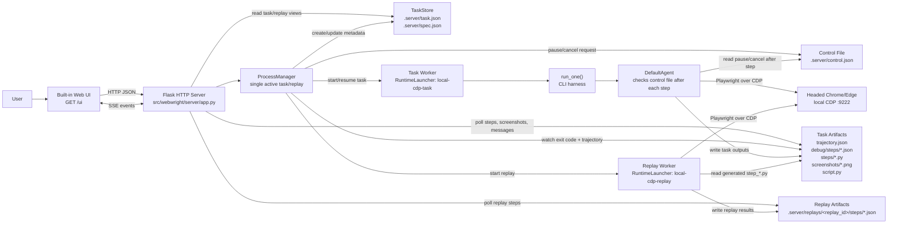

# Local CDP HTTP Server Design

## 文档状态

- 当前版本：`1.1`
- 更新时间：2026-07-21
- 状态：WebwrightHome、RuntimeLauncher、包内资源与 macOS 冻结 Server 基线已实现；Windows 与完整真实业务链待验收
- 适用范围：Python harness 的 `local_browser + local_cdp` 模式

本文档描述 Webwright Local CDP HTTP server 的当前实现。接口定义见
[`local_cdp_http_api.md`](./local_cdp_http_api.md)。本文档关注内部设计、进程模型、
状态流转、artifact 读取、内置 UI，以及第一版边界。

## 架构图



## 背景

Webwright 原本主要通过 CLI 启动探索循环。用户提供一个网址和自然语言任务，
harness 调用模型生成每一步浏览器操作代码，并通过 Playwright 驱动浏览器完成任务。

HTTP server 把这套 CLI harness 包装成本机服务，方便接入 Web UI：

- 用户在 UI 中输入目标网址和任务内容。
- UI 能看到任务进度、每一步生成的 `python_code`、截图和最终答案。
- 用户可以在真实有头浏览器中手动完成登录、MFA、验证码、授权等操作。
- agent 可以在用户操作后继续执行。
- 用户可以回放已经生成的步骤。

第一版只支持一种运行模式：

```text
local_browser + local_cdp
```

也就是 Webwright 通过 CDP 连接本机真实有头 Chrome 或 Edge。其他模式不纳入 server
设计：

- 不支持 Browserbase。
- 不支持 `local_workspace`。
- 不支持 `local_launch`。
- 不支持 `local_persistent`。
- 不支持 `persistent_browser.yaml`。
- 不暴露 `bash_command` 或 `final_script.py` 工作流。

## 当前实现摘要

当前实现采用 Flask + 子进程执行模型：

```text
Web UI
  |
  | HTTP / SSE
  v
Webwright HTTP Server
  |
  | creates task_id + absolute output_dir
  | writes .server/spec.json
  | starts one child process
  v
Child Process
  |
  | RuntimeLauncher.worker_command("local-cdp-task", spec_path)
  | calls run_one(..., resolved_output_dir=...)
  v
Webwright local_browser + local_cdp
  |
  | writes artifacts
  v
~/.weworker/webwright/tasks/<task_id>/
  .server/
    task.json
    spec.json
    control.json
    process.log
    replays/<replay_id>/
  trajectory.json
  debug/steps/*.json
  steps/*.py
  screenshots/*.png
  script.py
```

HTTP server 不在请求上下文中直接调用 `run_one()`、`model.query()` 或 `agent.step()`。
它只负责：

- 管理 task/replay 元数据。
- 写入子进程 spec。
- 启动、取消和观察子进程。
- 读取 artifacts 构造 API 响应。
- 用 artifacts polling 生成 SSE。
- 提供内置 `/ui` 前端和 `/api/docs` 接口文档。

## 入口与模块

已实现的 server 相关文件：

```text
src/webwright/server/
  __init__.py
  app.py
  artifacts.py
  browser.py
  process_manager.py
  records.py
  ui.py

src/webwright/run/
  server.py
  local_cdp_task.py
  local_cdp_replay.py
```

职责划分：

- `app.py`: Flask app、HTTP routes、SSE、运行时 Markdown/OpenAPI 文档。
- `artifacts.py`: 读取 task 输出目录，构造 steps、script、messages、file response。
- `browser.py`: CDP status 和 tabs 查询。
- `process_manager.py`: 单 active subprocess、pause/cancel、进程状态监控。
- `records.py`: task/replay 元数据读写、ID sanitize、原子 JSON 写入。
- `ui.py`: 内置单页 UI，访问 `/` 或 `/ui` 即可使用。
- `run/server.py`: server 启动入口。
- `run/local_cdp_task.py`: task/resume 子进程入口。
- `run/local_cdp_replay.py`: replay 子进程入口。
- `artifacts.py`：只读，读取 harness 运行产物（`trajectory.json`、`debug/steps/*.json`、
  `steps/*.py`、`screenshots/*.png`、`script.py`），整理成 API 响应。
- `records.py`：可读可写，管理 server 自己维护的元数据（`task.json`、`replay.json`、
  `spec.json`、`control.json`），提供 `TaskStore`、ID sanitize 和 `atomic_write_json`。

一句话：`artifacts.py` 是「看结果」，`records.py` 是「存档案」。

`pyproject.toml` 暴露了脚本入口：

```bash
uv run webwright-server
```

等价的模块入口：

```bash
uv run python -m webwright.run.server --host 127.0.0.1 --port 8765
```

`run/server.py` 使用：

```python
flask_app.run(host=host, port=port, debug=False, use_reloader=False, threaded=True)
```

也就是说第一版按单 Flask 进程运行，禁用 reloader，避免同一 server 被 debug reloader
启动两份进程。

源码入口与安装版入口共享同一个 bootstrap：

```text
源码模式：uv run webwright-server
安装模式：<InstallRoot>/webwright
内部 Worker：RuntimeLauncher 根据运行形态选择 python -m 或 --internal-worker
```

安装版的 `--internal-worker` 与 `--internal-script` 只属于进程内部协议，不进入普通
用户帮助或 HTTP API。bootstrap 在导入可能使用多进程的模块前调用
`multiprocessing.freeze_support()`。

## 关键约束

### 单机无鉴权

server 面向单机 UI 使用，默认监听：

```text
127.0.0.1:8765
```

当前实现不提供鉴权、用户隔离、多租户、CSRF 或 Origin 防护。不要把它直接暴露到不可信网络。

### 单 active task/replay

本机真实浏览器是共享资源。多个 agent 同时通过 CDP 操作同一个浏览器会互相干扰。

当前实现通过 `ProcessManager` 在单个 server 进程内保证：

```text
任意时刻最多只有一个 Webwright task 或 replay 在执行。
```

如果已有 task/replay 子进程仍在运行，新的创建、续聊、resume 或 replay 请求返回
`409 Conflict`。

第一版只保证单个 server 进程内的互斥。server 重启、跨 server 进程锁、多 worker、
旧子进程恢复都不纳入第一版。

### server 决定输出目录

每次创建任务时，server 生成：

```text
~/.weworker/webwright/tasks/<task_id>
```

续聊和 resume 复用原 task 的 output dir。

server 写入 `.server/spec.json`、`.server/task.json`、子进程命令行参数、
`agent.control_path`、`resume_from` 时均使用绝对路径。API 隐藏 output dir；
`~/.weworker/webwright/tasks/<task_id>` 是统一默认布局；测试通过临时 `WEBWRIGHT_HOME`
注入隔离目录，不写入真实用户 Home。

### InstallRoot 与 WebwrightHome

完整分发把只读程序目录与可写用户数据严格分开：

```text
InstallRoot：可执行文件、Python 依赖、Playwright driver、内置 YAML 和 Web UI
WebwrightHome：~/.weworker/webwright，由 WeWorker 通过 WEBWRIGHT_HOME 绝对路径固定注入
```

Server 只从 InstallRoot 读取包内资源；Task、Toolkit、模型配置、浏览器 Profile、
Runtime 状态和应用日志只写入 WebwrightHome。卸载默认不删除 WebwrightHome。

### 子进程隔离 event loop

Webwright 模型调用内部使用：

```python
webwright.utils.runtime.run_async()
```

该函数如果发现当前线程已有正在运行的 asyncio event loop，会抛出：

```text
RuntimeError("Webwright does not support running inside an active event loop.")
```

当前实现让 Webwright task 和 replay 都在独立 Python 子进程中执行，从根上避免 HTTP
server 与 Webwright 内部 event loop 冲突，也为未来迁移异步 HTTP 框架保留空间。

## 默认运行配置

server task 默认使用：

```text
base.yaml
local_browser.yaml
model_zhipu.yaml
environment.environment_class=local_browser
environment.browser_mode=local_cdp
environment.local_cdp_new_page=true
environment.local_cdp_auto_start=true
environment.local_cdp_url=<configured server CDP URL>
model.action_field=python_code
agent.control_path=<absolute .server/control.json>
agent.control_run_id=<run_id>
```

`model_zhipu.yaml` 是当前默认模型配置；它通过智谱 Chat Completions 的 JSON mode
强制 agent action 使用 JSON，避免仅靠 prompt 约束的格式重试循环。CDP endpoint 默认来自 `browser.py` 的
`DEFAULT_CDP_URL`，即：

```text
http://127.0.0.1:9222
```

如果 CDP endpoint 不可达，task/replay 执行时会沿用 `local_cdp_auto_start=true`
的 CLI 行为自动启动 Chrome/Edge。

## Task 元数据

server 自己维护 task 元数据，不依赖 `trajectory.json` 作为唯一状态源。

每个 task 输出目录下写：

```text
.server/task.json
.server/spec.json
.server/control.json
.server/process.log
```

### `.server/task.json`

示例：

```json
{
  "task_id": "mail_apple_20260708_153000",
  "title": "163 邮箱 Apple 邮件搜索",
  "instruction": "搜一下 apple 给我发了哪些邮件",
  "start_url": "https://mail.163.com",
  "status": "running",
  "output_dir": "/Users/example/.webwright/tasks/mail_apple_20260708_153000",
  "created_at": "2026-07-08T15:30:00+08:00",
  "updated_at": "2026-07-08T15:31:12+08:00",
  "current_step": 4,
  "final_response": "",
  "error": "",
  "last_run_id": "run_20260708_153000_001",
  "last_child_pid": 12345
}
```

`records.TaskStore` 使用 `atomic_write_json()` 写 task/replay/spec/control 文件：

```text
write .<name>.tmp -> replace final file
```

这避免 server 自己写出的 JSON 被读到半文件。

### `.server/spec.json`

`local_cdp_task.py` 读取这个文件并调用 `run_one()`。

新建任务示例：

```json
{
  "mode": "start",
  "task_id": "mail_apple_20260708_153000",
  "run_id": "run_20260708_153000_001",
  "instruction": "搜一下 apple 给我发了哪些邮件",
  "start_url": "https://mail.163.com",
  "resolved_output_dir": "/Users/example/.webwright/tasks/mail_apple_20260708_153000",
  "config_spec": [
    "base.yaml",
    "local_browser.yaml",
    "model_zhipu.yaml",
    "environment.environment_class=local_browser",
    "environment.browser_mode=local_cdp",
    "environment.local_cdp_new_page=true",
    "environment.local_cdp_auto_start=true",
    "model.action_field=python_code",
    "agent.control_path=/Users/example/.webwright/tasks/mail_apple_20260708_153000/.server/control.json",
    "agent.control_run_id=run_20260708_153000_001"
  ],
  "resume_from": null,
  "followup": null
}
```

续聊/resume 示例：

```json
{
  "mode": "resume",
  "task_id": "mail_apple_20260708_153000",
  "run_id": "run_20260708_153200_002",
  "instruction": "搜一下 apple 给我发了哪些邮件",
  "start_url": "https://mail.163.com",
  "resolved_output_dir": "/Users/example/.webwright/tasks/mail_apple_20260708_153000",
  "config_spec": [
    "base.yaml",
    "local_browser.yaml",
    "model_zhipu.yaml",
    "environment.environment_class=local_browser",
    "environment.browser_mode=local_cdp",
    "environment.local_cdp_new_page=true",
    "environment.local_cdp_auto_start=true",
    "model.action_field=python_code",
    "agent.control_path=/Users/example/.webwright/tasks/mail_apple_20260708_153000/.server/control.json",
    "agent.control_run_id=run_20260708_153200_002"
  ],
  "resume_from": "/Users/example/.webwright/tasks/mail_apple_20260708_153000/trajectory.json",
  "followup": "用户已完成扫码登录，继续完成任务。"
}
```

每次 start/resume/replay 前，`ProcessManager` 都会删除旧的 `.server/control.json`，
避免上一次 pause/cancel 污染新 run。

### `.server/control.json`

server 通过控制文件向 task 子进程发送协作式控制信号。

暂停：

```json
{
  "run_id": "run_20260708_153000_001",
  "action": "pause",
  "reason": "需要用户扫码登录",
  "created_at": "2026-07-08T15:31:00+08:00"
}
```

取消：

```json
{
  "run_id": "run_20260708_153000_001",
  "action": "cancel",
  "reason": "用户取消任务",
  "created_at": "2026-07-08T15:31:00+08:00"
}
```

控制文件只对当前 active `run_id` 生效；`DefaultAgent` 读到不匹配的 `run_id` 时会忽略。

## 子进程入口

### Task 子进程

入口：

```text
RuntimeLauncher.worker_command("local-cdp-task", /abs/path/to/.server/spec.json)
```

职责：

- 读取 `.server/spec.json`。
- 校验 `mode` 只能是 `start` 或 `resume`。
- 调用 `run_one()`。
- 将 `resolved_output_dir` 原样传给 `run_one()`。
- `start` 时传入 `task`，`resume` 时传入 `resume_from` 和 `followup`。
- 正常结束打印 `{"ok": true, "result": ...}`。
- 异常时 stderr 打印 `{"ok": false, "error": ...}` 并返回 exit code 1。

子进程 stdout/stderr 由 `ProcessManager._spawn()` 追加写入：

```text
.server/process.log
```

server 不解析 stdout 来推导 output dir 或 task 状态。

`ProcessManager` 注入 `RuntimeLauncher`，只传逻辑 Worker 名称。源码模式由当前 Python
解释器执行模块；冻结模式由 Webwright 可执行文件经 `--internal-worker` 回到同一
`main(argv)`。每个子进程的 `cwd` 显式设置为当前 Run 目录，所有 Spec 路径均为绝对路径。

内部 Worker 与系统浏览器使用不同环境：内部 Worker 保留冻结 Runtime 的动态库和
Playwright driver 环境；Chrome／Edge 使用 `external_process_environment()` 清除
PyInstaller 修改的 DLL／动态库搜索变量，避免系统浏览器加载包内库。

### Replay 子进程

入口：

```text
RuntimeLauncher.worker_command("local-cdp-replay", /abs/path/to/.server/replays/<replay_id>/replay_spec.json)
```

职责：

- 使用 `LocalBrowserEnvironment` 连接 `local_cdp`。
- `local_cdp_auto_start=true`，CDP 不可达时可自动启动 Chrome/Edge。
- 新任务首次执行时，`LocalBrowserEnvironment` 把
  `await page.goto("<start_url>", wait_until="domcontentloaded")` 固定注入为
  `step_0001.py` 第一条语句；真实执行、`script.py` 和回放使用同一份合并代码。
- resume 从已有步骤编号继续，不重复注入首次导航。
- 根据 `from_step` / `to_step` 读取原 task 的 `steps/step_*.py`。
- 逐步调用 `env.execute({"python_code": code})`。
- 每步写 `.server/replays/<replay_id>/steps/step_0001.json`。
- 步骤缺失或执行 returncode 非 0 时停止并返回 exit code 1。
- 正常全部回放完成时返回 exit code 0。

## DefaultAgent 协作式控制

`src/webwright/agents/default.py` 的 `AgentConfig` 增加：

```python
control_path: Path | None = None
control_run_id: str = ""
```

`DefaultAgent._run_loop()` 在每一步 `step()` 完成并保存 `trajectory.json` 后检查控制文件：

```python
self.save(self.config.output_path)
if self.messages[-1].get("role") == "exit":
    break
control_exit = self._check_control_file()
if control_exit is not None:
    self.add_messages(control_exit)
    self.save(self.config.output_path)
    break
```

`_check_control_file()` 行为：

- 文件不存在时返回 `None`。
- `OSError` 或 `JSONDecodeError` 时返回 `None`，下一步后再检查。
- control payload 不是 JSON object 时忽略。
- 如果配置了 `control_run_id`，payload 中的 `run_id` 必须完全匹配。
- 只接受 `pause` 和 `cancel` 两种 action。

pause 会追加：

```json
{
  "role": "exit",
  "content": "Task paused by server.",
  "extra": {
    "exit_status": "Paused",
    "submission": "",
    "final_response": ""
  }
}
```

cancel 会追加：

```json
{
  "role": "exit",
  "content": "Task cancelled by server.",
  "extra": {
    "exit_status": "Cancelled",
    "submission": "",
    "final_response": ""
  }
}
```

这是一种协作式控制：pause/cancel 只有在当前模型请求和当前 browser step 完成后才会被
agent 观察到。浏览器处于 `local_cdp` 模式时，`env.close()` 只断开 Playwright 连接；
默认不关闭用户真实浏览器。

## ProcessManager 状态模型

`process_manager.py` 维护单个 active subprocess：

```python
active_process: subprocess.Popen | None
active_kind: Literal["task", "replay"] | None
active_id: str | None
active_task_id: str | None
active_run_id: str | None
lock: threading.Lock
```

### start task

流程：

1. 获取 lock。
2. 如果 active process 仍在运行，抛 `BusyError`，HTTP 层返回 `409`。
3. 如果请求携带 `target_id`，确认 target 存在且 URL 与 `start_url` 完全匹配，然后激活该页面。
4. 生成 sanitized task_id。
5. 生成 run_id。
6. 生成 absolute output dir。
7. 删除旧 `.server/control.json`。
8. 写 `.server/task.json`，初始状态 `queued`。
9. 写 `.server/spec.json`，其中路径全部为绝对路径，并保存 `target_id`。
10. `subprocess.Popen([...])` 启动 `webwright.run.local_cdp_task`。
11. 子进程严格接管准备页面，不创建新标签页，不重新导航 `start_url`。
12. 更新 task 状态为 `running`，记录 pid、run_id。
13. 保存 active process，并启动 watcher thread。
14. HTTP 返回 task_id、status、events_url、steps_url。

### continue task

`POST /api/tasks/{task_id}/messages` 和 `POST /api/tasks/{task_id}/resume` 都调用
`ProcessManager.continue_task()`。

流程：

1. 获取 lock。
2. 如果已有 active process，返回 `409`。
3. 读取原 task。
4. 若是 `/resume`，要求 task 状态为 `waiting_for_user` 或 `paused`。
5. 确认原 output dir 下存在 `trajectory.json`。
6. 生成新的 run_id。
7. 删除旧 `.server/control.json`。
8. 写 resume spec，`resume_from` 指向原 task 的 absolute `trajectory.json`。
9. 启动新的 `local_cdp_task` 子进程。
10. 更新 task 状态为 `running`，记录新的 pid、run_id。

### pause task

流程：

1. 只能暂停当前 active task；否则返回 `409`。
2. 写 `.server/control.json`，其中 `run_id` 等于当前 active run。
3. 更新 task 状态为 `pause_requested`。
4. HTTP 响应立即返回 `pause_requested`。
5. 子进程在当前 step 完成、保存 artifacts、检查 control file 后自然退出。
6. watcher 读取 `trajectory.json`，看到 `exit_status=Paused` 后把 task 更新为
   `waiting_for_user`。

UI 只有在 task 进入 `waiting_for_user` 后才应提示用户可以接管浏览器。

### cancel task

默认是协作式取消：

1. 写 `.server/control.json`，action 为 `cancel`。
2. 更新 task 状态为 `cancel_requested`。
3. 子进程在当前 step 完成后退出。
4. watcher 看到 `exit_status=Cancelled` 后把 task 更新为 `cancelled`。

强制取消通过：

```text
POST /api/tasks/{task_id}/cancel?force=true
```

强制取消会对 active child process 先 `terminate()`，等待 2 秒后仍未退出则 `kill()`，
并把 task 状态写为 `cancelled`。强杀后 artifacts 可能停留在半步状态。

如果 cancel 请求的 task 不是当前 active task：

- 若 task 已经是 terminal，直接返回当前 task。
- 否则当前实现会把 task 更新为 `cancelled`。

### replay

Replay 也遵守单 active process。

启动 replay 时：

1. 获取 lock。
2. 如果已有 active process，返回 `409`。
3. 读取原 task。
4. `new_tab=false` 时，按 `task.active_target_id`、trajectory target 的顺序选择仍存在的 target；都不可用时由子进程新建页面。`new_tab=true` 始终新建。
5. 生成 replay_id。
6. 创建 `.server/replays/<replay_id>/`。
7. 删除旧 `.server/control.json`。
8. 写 replay metadata 和 `replay_spec.json`，包含 `start_url` 与候选 `target_id`。
9. 启动 `webwright.run.local_cdp_replay` 子进程。
10. 子进程准备页面后立即写 `runtime.json`，记录实际 `target_id`；复用失败会自动新建页面。
11. watcher 先用 `runtime.json` 更新 task `active_target_id`，再把 replay 状态更新为 `succeeded`、`failed` 或 `cancelled`。

取消 replay 使用强制终止子进程的方式，并把 replay 状态写为 `cancelled`。
首次任务、follow-up 和 replay 共用 task `active_target_id`。Follow-up spec 使用该字段覆盖旧 trajectory target；任务子进程退出后，再用最新 trajectory target 回写该字段，确保「任务 → 回放 → Follow-up → 再回放」始终围绕同一个 tab。

## 状态流转

Task status:

```text
queued
running
pause_requested
waiting_for_user
paused
cancel_requested
succeeded
failed
cancelled
```

API 文档里保留 `starting_browser` 作为状态枚举，但当前实现没有单独写入这个状态。
`paused` 也作为兼容状态保留；当前 pause watcher 的目标状态是 `waiting_for_user`。

子进程退出时，watcher 读取 `trajectory.json` 最后一条 `exit` message：

```json
{
  "extra": {
    "exit_status": "Submitted",
    "final_response": "..."
  }
}
```

映射规则：

```text
Submitted      -> succeeded
Paused         -> waiting_for_user
Cancelled      -> cancelled
LimitsExceeded -> failed
returncode 0 + final_response -> succeeded
returncode 0 + no final_response -> failed
returncode != 0 -> failed
```

Replay status:

```text
queued
running
succeeded
failed
cancelled
```

Replay watcher 根据子进程 exit code 映射：

```text
0     -> succeeded
非 0  -> failed
```

## Artifact 读取

`artifacts.py` 负责把输出目录转换成 API 响应。

### JSON 读取

JSON artifact 读取使用：

```python
read_json_with_retries(path, attempts=3, delay_seconds=0.05)
try_read_json(path, attempts=3, delay_seconds=0.05)
```

遇到 `OSError` 或 `JSONDecodeError` 时短暂重试。重试后仍失败：

- `try_read_json()` 返回 `None`。
- `read_steps()` 会跳过当前不可读 debug step，必要时回退到 step `.py` 文件。
- `read_messages()` / `exit_status()` 返回空视图。

这避免 polling 正好撞上写入中的 JSON 半文件时把 task 误判为失败。

### steps

数据源：

```text
debug/steps/step_0001.json
steps/step_0001.py
screenshots/step_0001.png
```

规则：

- 从 `debug/steps/*.json` 和 `steps/*.py` 合并 step number。
- 优先读取 debug step。
- 如果 debug step 中缺少 `python_code`，回退到 `steps/step_*.py`。
- `code_type` 固定为 `python_code`。
- 如果存在截图，`screenshot_url` 指向 file API。
- 若只有 `.py` 文件，没有 debug JSON，则返回 `status="unknown"` 的 step。

### script

读取：

```text
script.py
```

不存在时返回空字符串。

### messages

读取：

```text
trajectory.json
```

返回 UI-safe 版本：

- 保留 role、content、kind。
- 省略 data URL 图片，替换为 `<omitted:data-url>`。
- 大文本默认截断到 8000 字符。

### files

文件 API 限制在 task output dir 内：

- 拒绝绝对路径。
- 拒绝 `..`。
- `resolve()` 后必须仍在 task output dir 下。
- 文件不存在返回 `404`。

## SSE 与内置 UI

当前实现的进度推送不是 agent 主动事件，而是 server 从 artifacts polling 生成 SSE。

`GET /api/tasks/{task_id}/events`：

1. 读取 task metadata。
2. 每 750ms 读取 task、steps 和截图。
3. 对新 step 发送 `step_finished`。
4. 对 task 状态变化发送对应事件。
5. 当状态进入 `waiting_for_user`、`paused`、`succeeded`、`failed`、`cancelled` 时结束 SSE。

Task 事件映射：

```text
running           -> task_started
pause_requested   -> pause_requested
cancel_requested  -> cancel_requested
waiting_for_user  -> waiting_for_user
succeeded         -> task_succeeded
failed            -> task_failed
cancelled         -> task_cancelled
```

`GET /api/replays/{replay_id}/events`：

1. 每 750ms 扫描 replay steps。
2. 对新 replay step 发送 `replay_step_finished`。
3. 对 replay 状态变化发送对应事件。
4. 当 replay 状态进入 `succeeded`、`failed`、`cancelled` 时结束 SSE。

内置 UI：

- `/` 重定向到 `/ui`。
- `/ui` 渲染 `server/ui.py` 中的单页前端。
- UI 创建任务后订阅 task SSE。
- 切换 task、进入终止/等待状态或 SSE error 时关闭 `EventSource`，避免 Events 一直轮询。
- UI 提供 API Docs 按钮打开 `/api/docs`。

## API 实现映射

主要 routes：

```text
GET  /                         -> redirect /ui
GET  /ui                       -> built-in task UI
GET  /api/docs                 -> runtime Markdown API doc
GET  /api/openapi.json         -> OpenAPI-style endpoint index
GET  /api/health               -> server health
GET  /api/browser/status       -> CDP status
POST /api/browser/open         -> open or focus Agent browser
GET  /api/browser/match        -> match first exact tab by URL
GET  /api/browser/tabs         -> CDP tabs
GET  /api/tasks                -> list tasks
POST /api/tasks                -> create + start task
GET  /api/tasks/{task_id}      -> task view
GET  /api/tasks/{task_id}/events
GET  /api/tasks/{task_id}/steps
GET  /api/tasks/{task_id}/steps/{step}
GET  /api/tasks/{task_id}/script
GET  /api/tasks/{task_id}/messages
POST /api/tasks/{task_id}/messages
POST /api/tasks/{task_id}/pause
POST /api/tasks/{task_id}/resume
POST /api/tasks/{task_id}/cancel
POST /api/tasks/{task_id}/replay
GET  /api/tasks/{task_id}/files/{path}
GET  /api/replays/{replay_id}
GET  /api/replays/{replay_id}/events
POST /api/replays/{replay_id}/cancel
```

HTTP 层错误映射：

```text
ValueError       -> 400 invalid_request
FileNotFoundError -> 404 not_found
NotFoundError    -> 404 not_found
BusyError        -> 409 busy
InvalidStateError -> 409 invalid_state
```

`/api/docs` 和 `/api/openapi.json` 由 `app.py` 运行时生成，是接口索引和简明说明，不是完整
schema-first OpenAPI 规范。

## 测试覆盖

当前已加入的测试覆盖：

- `tests/unit/test_agent_control.py`
  - pause control file 写入 `Paused` exit message。
  - 不匹配 run_id 的 control file 会被忽略。
- `tests/unit/test_server_app.py`
  - health、UI、docs、OpenAPI endpoint。
  - task SSE 在 `waiting_for_user` 时结束。
  - `POST /api/tasks` 调用 process manager。
- `tests/unit/test_server_artifacts.py`
  - steps/script/messages/file path 读取。
  - JSON 半文件短重试。
  - path traversal 拒绝。
- `tests/unit/test_server_process_manager.py`
  - start task 写绝对 spec 并清理旧 control。
  - pause 写带 run_id 的 control 并设置 `pause_requested`。
  - paused exit 映射到 `waiting_for_user`。
  - busy 时拒绝新的 task/replay。
  - replay 启动、取消和状态更新。
- 路径、Runtime 与冻结合同测试
  - 默认和 `WEBWRIGHT_HOME` 覆盖路径。
  - 源码／冻结两类 Worker 与脚本命令。
  - Worker 白名单、绝对 Spec、显式 `cwd` 和环境分类。
  - 包内 YAML、Web UI 与 canonical Toolkit Runtime 可读取。

验证命令：

```bash
uv run pytest -q
```

## 手工验证流程

启动 server：

```bash
uv run webwright-server
```

冻结模式还必须在不依赖源码仓库、Python 或 uv 的干净环境中，从 InstallRoot 启动
Webwright，完成 Exploration、Replay、暂停／继续、取消和浏览器自动启动；重启后确认
`~/.weworker/webwright/tasks` 与浏览器 Profile 保留。macOS 和 Windows 必须分别实机验证。

打开 UI：

```text
http://127.0.0.1:8765
```

接口文档：

```text
http://127.0.0.1:8765/api/docs
http://127.0.0.1:8765/api/openapi.json
```

也可以用 curl 创建任务：

```bash
curl -X POST http://127.0.0.1:8765/api/tasks \
  -H 'Content-Type: application/json' \
  -d '{"start_url":"https://mail.163.com","instruction":"搜一下 apple 给我发了哪些邮件"}'
```

暂停/人工接管流程：

1. 在 UI 或 API 请求 pause。
2. API 立即返回 `pause_requested`。
3. 等 task 状态变为 `waiting_for_user`。
4. 用户在真实浏览器中完成登录、MFA、验证码或授权。
5. 在 UI 或 API 请求 resume。

## 第一版边界

第一版不做：

- 多 task 排队执行。
- 多浏览器并发。
- server 重启后的 active process 恢复。
- 跨 server 进程/多 worker 的互斥锁。
- 用户鉴权。
- CSRF / Origin 防护。
- 远程访问安全模型。
- 强制中断正在进行中的模型请求。
- 强制 kill 后的 artifact 修复。
- `final_script.py` 生成与验证。
- workspace/persistent browser/Browserbase 模式。
- 完整 schema-first OpenAPI 规范。

第一版重点：

```text
把现有 CLI harness 稳定包装成本机 HTTP API 和内置 UI，
让用户能创建任务、看步骤、暂停给人登录、续聊、回放。
```

## 后续可演进方向

- 在 API/UI 增加模型配置选择，但默认继续使用 `model_zhipu.yaml`。
- 把 `/api/openapi.json` 扩展成完整 request/response schema。
- 增强 replay UI，显示 replay steps、错误和截图。
- 增加 server 重启后的 task/replay 状态修复。
- 如果需要更细粒度控制，再把 agent loop 抽象为可内嵌单步 runner。
